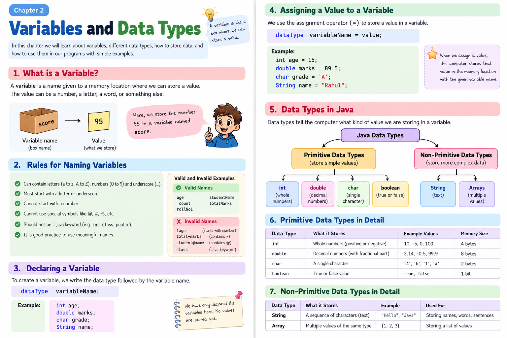

# Chapter 2: Variables — Giving Information a Name

> **Today’s goal:** Store values such as a name, age or score so a program can use them later.

---

## 1. Imagine a labelled box

A variable is like a labelled box in which we store a value.

```text
        Variable name: score
       ┌───────────────────┐
       │        95         │  ← Value stored inside
       └───────────────────┘
```

If the score changes, we can put a new value in the variable.

---

## 2. Create your first variable

```java
int score = 95;

System.out.println(score);
```

Output:

```text
95
```

Read the first line like this:

- `int` tells Java what kind of value we want to store.
- `score` is the name we chose.
- `=` stores the value in the variable.
- `95` is the value.

The whole line creates a variable and gives it a value.

---

## 3. Variables can store different kinds of information

| Type | What it stores | Example |
|---|---|---|
| `int` | Whole numbers | `int age = 15;` |
| `double` | Decimal numbers | `double price = 25.50;` |
| `char` | One character | `char grade = 'A';` |
| `boolean` | `true` or `false` | `boolean passed = true;` |
| `String` | Text | `String name = "Riya";` |

Notice the quotation marks:

- Text uses double quotes: `"Riya"`
- A `char` uses single quotes: `'A'`

`String` starts with a capital `S`.

---

## 4. A variable can change

```java
int score = 50;

System.out.println(score);

score = 80;

System.out.println(score);
```

Output:

```text
50
80
```

The second assignment replaces the old value.

```text
score = 50   ── change it ──►   score = 80
```

---

## 5. Naming variables

Choose names that explain what the value means.

**Good names**

```java
int age = 15;
int totalMarks = 450;
String studentName = "Riya";
```

**Names to avoid**

```java
int 2age = 15;          // Starts with a number
int total-marks = 450;  // Contains a hyphen
```

Variable names cannot contain spaces or start with a number. Java is case-sensitive, so `age` and `Age` are different names.

---

## 6. Put variables together

```java
String name = "Riya";
int age = 15;

System.out.println("Name: " + name);
System.out.println("Age: " + age);
```

Output:

```text
Name: Riya
Age: 15
```

The `+` joins text and a value when used in these print statements.

---

## Practice time

1. Create variables for your name, age and favourite letter.
2. Store marks in three subjects and display them.
3. Store an item's price and quantity.
4. Create a variable named `score`, print it, change it and print it again.
5. Pick the correct type for a person's age, a shop price, a grade and a yes/no answer.
6. Fix the invalid variable names: `my name`, `3marks`, `total-marks`.
7. Store a person's name and age, then print a sentence using both values.

<details>
<summary>Need a hint? Open this</summary>

- **Tip 1:** Ask yourself: is the value a whole number, decimal, character, true/false or text?
- **Tip 2:** Use double quotes for `String` and single quotes for `char`.
- **Tip 3:** Give variables meaningful names.
</details>

---

## Quick recap

A variable has a **type**, a **name** and a **value**. We use variables to remember information and use it later.


## Visual guide


